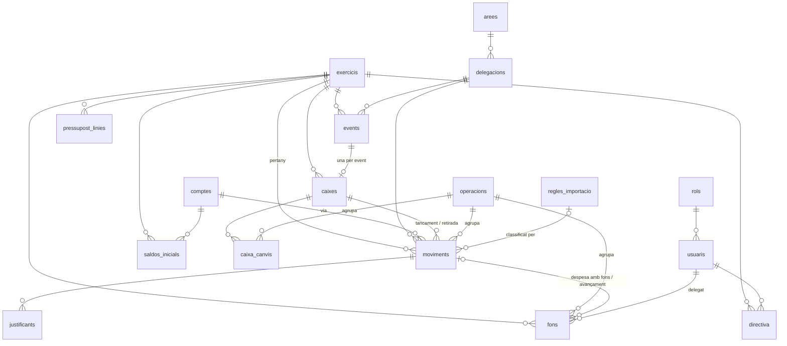

# Model de dades — Falla Portal a Supabase
## Redactat: 2026-10-13 · Actualitzat: 2026-10-14 (Fase 1: SQL i permisos) · Decisions: D-021, D-024, D-025, D-027–D-031, D-035–D-037

L'esquema implementat és a `supabase/migrations/` (8 fitxers) i els tests a `supabase/tests/` (§9.6). On aquest
document i l'SQL no coincidisquen, mana l'SQL i cal corregir el document.

Aquest document es llig sense context previ. Substitueix l'esborrany de taules del §4 de
`PLA_MIGRACIO_SUPABASE.md`. Es basa en `INVENTARI_FUNCIONAL.md` (què fa l'app), `INFORME_ANOMALIES_F0.md`
(què falla) i el perfil de les dades reals del 2026-10-13.

---

## 1. Per què no copiar les pestanyes

L'esborrany anterior feia una taula per pestanya. Això trasllada a Postgres els defectes del full:

| Defecte del full | Conseqüència vista a les dades o al codi |
|---|---|
| `via` és un text que ha de coincidir amb `bancs.codi`, més dos valors màgics (`app`, `Virtual`) | Llistes de vies fixes al codi; el 03 Banc no surt al Flux (A-21) |
| Els moviments guarden còpies de noms (`areaNom`, `delegacioNom`, `eventNom`, `responsable`) | Noms desfasats; un esborrat deixa orfes que ningú detecta (A-14) |
| Una acció de l'usuari crea diversos registres sense cap vincle comú (traspàs = 2 moviments + 1 fons; tancament = 2 moviments + 1 fons; despesa amb fons = 1 moviment + 1 fons) | Esborrar-ne un deixa els altres: 4 avançaments orfes (A-24); reobrir una caixa esborra per coincidència de text (`fontImport`+`eventId`) |
| Els apunts de canvi de caixa viuen a `02 Fons` amb un delegat fals (`_event`) | Cal excloure'ls a mà a cada càlcul de saldo (A-05) |
| Un tancament "sense event" s'inventa un `eventId` (`_se_…`) | No pot haver-hi clau forana cap a events (A-05) |
| Estats globals dins d'un JSON (`estats_exercicis`, bloqueig de pressupost d'una sola fila) | Es perden o s'apliquen a l'any que no toca (A-01, A-11) |
| Patrons de regles com a text separat per comes, ids de regla sense rastre | No se sap quina regla ha classificat un moviment |
| `bankHash` tractat com a clau | No és únic a la realitat (A-04) |

## 2. Principis
1. **Cada fet es guarda una sola vegada.** Els noms es lligen per clau forana; res de còpies.
2. **Cada registre sap d'on ve**: qui l'ha creat, quan, i de quina **operació** forma part.
3. **Les regles que avui només posa la pantalla, les posa la base de dades** (claus foranes, `CHECK`, índexs únics,
   transicions d'estat).
4. **Comportament i xifres 1:1 (D-025).** Cap columna nova canvia un total. Una vista reprodueix la forma
   antiga dels moviments perquè la UI (que continua llegint `DB`) canvie el mínim a la Fase 3.
5. **Tipus reals**: `date`, `time`, `numeric(12,2)`, `boolean`, enumeracions; mai text per a números o dates.
6. **Res s'esborra sense rastre**: `audit_log` per triggers (D-024).

## 3. Visió de conjunt

Grups: **exercici i organització** (`exercicis`, `arees`, `delegacions`, `events`), **diners** (`comptes`,
`saldos_inicials`, `moviments`, `justificants`, `fons`, `caixes`, `caixa_canvis`, `operacions`),
**planificació** (`pressupost_linies`, `pressupost_estat`, `pressupost_historial`), **persones i permisos**
(`usuaris`, `rols`, `rol_moduls`, `rol_reports`, `directiva`), **importació** (`regles_importacio`,
`fallesapp_passiu`), **sistema** (`config`, `audit_log`).

---

## 4. Taules

Convencions:
- Totes les taules (menys el catàleg `moduls` i `audit_log`) tenen `creat_at`, `creat_per`, `modificat_at` i
  `modificat_per`. `creat_per` i `modificat_per` són claus foranes a `usuaris.id` (text), i les omple un trigger:
  el client no les pot falsejar. No es repeteixen a cada taula d'aquest document.
- Els `id` existents es **conserven** com a `text` (justificants i enllaços en depenen); les files noves reben
  `gen_random_uuid()::text`.
- Les enumeracions són `text` amb `CHECK`, no tipus `enum` (s'amplien sense migracions delicades).
- Les claus foranes cap a l'exercici són `on delete cascade`: eliminar un exercici n'esborra les dades (A-25) i tot
  queda al registre d'activitat.

### 4.1 Exercici i organització

**`exercicis`** — substitueix `exercicis`, `estats_exercicis` i part d'`anyFiscal` de `00 Config`.
| Columna | Tipus | Notes |
|---|---|---|
| `id` | text PK | `'25/26'`; `CHECK (id ~ '^\d{2}/\d{2}$')` |
| `data_inici`, `data_fi` | date | 01/04–31/03 (D-026), desades a cada exercici en lloc de fixes al codi (avui hi són en 4 llocs) |
| `data_obertura` | date | |
| `tancat` | boolean | **Bloqueja** altes, edicions i esborrats dels registres de l'exercici, excepte per excepció (D-029) |
| `data_tancament` | date | |
| `es_prova` | boolean | exercicis de prova |

**`arees`**: `id text PK` (`'01'`, `CHECK ~ '^\d{2}$'`), `nom`, `color` (ara es desa), `ordre`.
**`delegacions`**: `id text PK` (`'0102'`), `area_id FK`, `nom`; `UNIQUE (id, area_id)` per a la clau composta
de §4.2.
**`events`**: `id text PK`, `exercici_id FK`, `delegacio_id FK`, `nom`, `data_inici date`, `hora_inici time`,
`data_fi date`, `hora_fi time`, `responsable_id FK usuaris` (avui és un nom: A-07), `per_defecte boolean`. Índex
únic parcial: un sol `per_defecte` per exercici. **Sense columna d'estat**: el full només desa `pendent` i la pantalla
calcula l'estat per les dates; es continua calculant.
**`exercicis`** té una restricció d'exclusió: dos exercicis no es poden solapar, de manera que cada data té com a molt
un exercici.

### 4.2 Diners

**`comptes`** — substitueix `07 Bancs` i converteix `via` en clau forana.
| Columna | Tipus | Notes |
|---|---|---|
| `id` | text PK | conserva `b1`, `b2`, `b3`, `b4`, `b1779146131300` |
| `codi` | text UNIQUE | `01 Banc`, `Efectiu`, `TPV`… (el que es mostra) |
| `nom` | text | |
| `tipus` | enum `banc` \| `efectiu` \| `tpv` \| `virtual` | |
| `iban` | text | **obligatori** si és `banc`/`tpv` i buit si no (`CHECK`). El 02 Banc el té buit al full: l'script de la Fase 5 hi posa ES82 3159 0076 6426 7219 1729 (`DOMAIN_KNOWLEDGE.md`); el camp IBAN de l'Efectiu ("Aproximat") es descarta |
| `als_informes` | boolean | **reprodueix 1:1** l'exclusió de `via:'app'` de Dashboard, Resultats i Flux |

Un compte nou de tipus `virtual` per al valor màgic **`Virtual`** (bonificacions de falles.app, que sí compten com
a despesa). El valor `app` **no** es converteix en compte: els consums de falles.app van a `fallesapp_consums`, fora del
llibre major (D-031). El Flux i r4 passen a llistar els
comptes de la taula en lloc d'una llista fixa (A-21; els totals no canvien).

**`saldos_inicials`**: `PK (compte_id, exercici_id)`, `import numeric(12,2)`, `data date`. Clau forana real (A-03).

**`operacions`** — **nova**. Agrupa tot el que crea una acció de l'usuari, per esborrar-ho, desfer-ho o auditar-ho
junt.
| Columna | Tipus | Notes |
|---|---|---|
| `id` | text PK | |
| `tipus` | enum | `moviment_manual`, `despesa_amb_fons`, `avancament`, `lliurament`, `devolucio`, `reintegrament`, `ingres_tercer`, `traspas_banc_caixa`, `obrir_caixa`, `ampliar_canvi`, `retirada_caixa`, `tancar_caixa`, `importacio_extracte`, `importacio_csv`, `importacio_fallesapp`, `passiu_fallesapp`, `migracio` |
| `exercici_id` | FK | |
| `fitxer_nom`, `iban_detectat` | text | només importacions |
| `resum` | jsonb | p. ex. `{importades, ometudes, duplicats, files_ignorades}` (A-18: ja no s'ometen en silenci) |

Efectes: esborrar un moviment que forma part d'una operació proposa esborrar l'operació sencera (fi d'A-24 i
dels traspassos que quedaven solts); "desfer importació" esborra els moviments d'una importació; reobrir una
caixa esborra els moviments de l'operació `tancar_caixa`, no els que casen per text.

**`moviments`** — el llibre major. Una fila per ingrés o despesa.
| Columna | Tipus | Origen al full | Notes |
|---|---|---|---|
| `id` | text PK | `id` | es conserva tal qual (A-15) |
| `exercici_id` | FK not null | `anyFiscal` | **es calcula per la data** (trigger amb les dates de `exercicis`) llevat d'excepció (D-029) |
| `imputacio_excepcional` | boolean | — | true si l'exercici no és el de la data o s'ha escrit en un exercici tancat |
| `motiu_imputacio` | text | — | obligatori si `imputacio_excepcional`; en migrar: "Imputat al 25/26 a l'app antiga" |
| `data` | date not null | `data` | l'únic moviment sense data ja la té (31/03/2026, v4.0.71) |
| `tipus` | enum `ingres` \| `despesa` | `tipus` (`ing`/`gast`) | |
| `import` | numeric(12,2) `CHECK > 0` | `import` | |
| `compte_id` | FK not null | `via` | per `codi` |
| `area_id` | FK null | `areaId` | null = excepció d'importació sense classificar |
| `delegacio_id` | null | `delegacioId` | **FK composta `(delegacio_id, area_id) → delegacions(id, area_id)`**: la delegació sempre és de l'àrea |
| `event_id` | FK null | `eventId` real | |
| `caixa_id` | FK null | `eventId` sintètic `_se_…` o de tancament | |
| `operacio_id` | FK null | — | reconstruïda en migrar on es pot |
| `font` | enum | `origen` + `fontImport` + `origenFons` | `manual`, `ingres_tercer`, `traspas_banc_caixa`, `extracte`, `csv_generic`, `fallesapp_transaccions`, `fallesapp_tickets`, `fallesapp_entrades`, `fallesapp_bonificacio`, `tancament_caixa`, `retirada_caixa` |
| `pagament_efectiu` | enum null | `origenFons` | `caixa` \| `fons_lliurats` \| `avancament` (només despeses en efectiu) |
| `concepte`, `establiment`, `notes` | text | | |
| `responsable_id` | FK usuaris null | `responsableEmail` (només manuals) | qui ha fet el pagament o cobrament; **buit als importats** (D-030); si l'email no casa, `responsable_extern` text |
| `creat_per` | FK usuaris not null | `responsableEmail` (importats) | qui l'ha entrat o importat; als manuals migrats, el mateix responsable |
| `conciliacio` | enum `pendent` \| `conciliat` \| `no_aplica` | `conciliacio` | a l'alta la calcula el servidor amb la regla de `calcConciliacio` (el client no la pot posar); la migració porta la desada |
| `empremta` | text null | `bankHash` | **índex no únic** `(compte_id, empremta)` (A-04) |
| `regla_id` | FK null | (`assignatPer`, es perdia) | quina regla l'ha classificat |
| `motiu_sense_justificant` | text | `ticketMotiu` | |

Es deixen fora `areaNom`, `delegacioNom`, `eventNom`, `responsable` i `ticketUrl` (passa a `justificants`).

**`justificants`** — **nova**: `id`, `moviment_id FK on delete cascade`, `storage_path`, `nom_fitxer`, `tipus_mime`,
`mida`, `url_drive_original` (traçabilitat de la Fase 4). Un moviment pot tindre'n més d'un.

**`fons`** — només els diners en mans de **persones**.
| Columna | Tipus | Notes |
|---|---|---|
| `id` | text PK | |
| `exercici_id`, `data` | FK, date | `exercici_id` per la data, amb `imputacio_excepcional` + `motiu_imputacio` com a moviments (D-029) |
| `tipus` | enum | `lliurament`, `regularitzacio`, `despesa_fons`, `devolucio`, `avancament`, `reintegrament` |
| `delegat_id` | FK usuaris **not null** | ja no hi ha `_event` |
| `import` | numeric(12,2) `CHECK > 0` | |
| `origen` | enum null | `caixa` \| `tercer` \| `banc` (lliurament i reintegrament; avui es perdia) |
| `moviment_id` | FK moviments null, **`on delete cascade`** | obligatori per a `despesa_fons` i `avancament` (`CHECK`) |
| `operacio_id` | FK null | |
| `nota` | text | |
| `creat_per` | FK usuaris | l'antic `registratPer`; avui és un nom (A-07): es resol per nom en migrar |

**`caixes`** — substitueix `03 Tancaments`; una caixa d'event, amb o sense event.
| Columna | Tipus | Notes |
|---|---|---|
| `id` | text PK | conserva l'`eventId` antic com a id (també els `_se_…`) |
| `exercici_id` | FK | per la data, amb excepció com a moviments (D-029) |
| `event_id` | FK null | **índex únic parcial**: una caixa per event (1:1) |
| `descripcio` | text | obligatòria si no hi ha event (`CHECK`) |
| `data` | date | |
| `estat` | enum `oberta` \| `tancada` | transició només `oberta → tancada` i reobrir explícit |
| `efectiu`, `tpv`, `pagaments` | numeric(12,2) | `tpv` no genera moviment: arriba pel banc com a "ON <comerç> ddmm" (A-23, confirmat) |
| `area_id`, `delegacio_id` | FK | destí dels moviments del tancament |
| `notes` | text | ara es desa |

**Millora proposada (després del tall)**: quadrar el `tpv` de la caixa amb els apunts "ON <comerç> ddmm" de l'extracte i
assignar-los l'event i l'àrea de la caixa (avui queden a 01 Tresoreria sense event i el resultat de l'event no els inclou).

El **canvi** i les **retirades** no es guarden: es calculen (`caixa_canvis` i moviments `retirada_caixa` de la caixa).

**`caixa_canvis`** — els apunts que avui són `fons` amb `_event`: `id`, `caixa_id FK`, `data`, `tipus`
(`lliurament` \| `ampliacio` \| `devolucio`), `import CHECK > 0`, `operacio_id`.

### 4.3 Planificació
**`pressupost_linies`**: `id`, `exercici_id`, `delegacio_id FK`, `event_id FK null`, `concepte text null`,
`tipus` enum `event` \| `concepte` \| `varis`, `import numeric(12,2)` (`CHECK import > 0 OR tipus = 'varis'`), `notes`.
`UNIQUE NULLS NOT DISTINCT (exercici_id, delegacio_id, event_id, concepte)`. `Varis` deixa de ser una paraula
màgica i passa a ser un tipus; la lògica de recàlcul es manté igual (al client o en una funció).
**`pressupost_estat`**: `PK exercici_id`, `estat` enum `obert` \| `bloquejat`, `canviat_per`, `canviat_at` (A-11:
una fila per exercici).
**`pressupost_historial`**: `id`, `exercici_id`, `accio`, `usuari_id`, `data`, `motiu`.

### 4.4 Persones i permisos
Disseny d'Emilio (2026-10-14, D-036): rols → mòduls (lectura o edició) i persones → rols. Detall a §9.
**`usuaris`**: `id text PK`, `auth_user_id uuid UNIQUE FK auth.users` (s'omple en la primera entrada), `nom`,
`email text UNIQUE` en minúscules (un trigger el normalitza: A-30) i immutable, `actiu boolean`. Un usuari amb
registres **es desactiva** en lloc d'esborrar-se (les FK `creat_per` ho impedeixen; A-14): per a ell és el mateix
(no entra), i l'historial no queda orfe.
**`rols`**: `id`, `nom`, `color`, `de_sistema` (els de sistema no s'esborren). Ja no té permisos propis: els permisos
són a `rol_moduls`.
**`moduls`**: catàleg fix (el defineix el codi): `id`, `nom`, `ordre`, `admet_edicio`, `admet_abast`,
`que_permet_edicio`. Llista a §9.2.
**`rol_moduls`**: `PK (rol_id, modul_id)`, `nivell` (`lectura` \| `edicio`), `abast` (`tot` \| `directiva`), `barra`
(barra inferior del mòbil). Sense fila = el rol no té el mòdul. Substitueix els 6 permisos de `14 Rols`, el JSON
`modulVis` i el JSON `reportVis` (els reports r1–r4 són mòduls).
**`usuari_rols`**: `PK (usuari_id, rol_id)`. Una persona té d'1 a N rols; sense cap rol no és membre.
**`directiva`**: `id`, `exercici_id`, `usuari_id`, `area_id null`, `delegacio_id null`,
`CHECK (exactament un dels dos)`, `UNIQUE NULLS NOT DISTINCT (exercici_id, usuari_id, area_id, delegacio_id)`.

### 4.5 Importació
**`regles_importacio`**: `id`, `compte_id FK null` (null = tots els comptes), `patrons text[]`, `tipus` enum
`assignar` \| `tpv` \| `ignorar`, `sentit` enum `ingres` \| `despesa` \| `qualsevol`, `area_id`, `delegacio_id`,
`concepte`, `prioritat int`, `activa`. Com que no hi ha compte `app` (D-031), si el full té regles amb font `'app'`
l'script de la Fase 5 les ha de llistar perquè Emilio decidisca.
**`fallesapp_passiu`**: `id`, `exercici_id`, `data`, `total`, `fallers`, `operacio_id` — es guarda l'historial;
la pantalla mostra l'últim de l'exercici (1:1).

**`fallesapp_consums`** — **decidit (D-031, 2026-10-13)**. Què fa avui l'app amb falles.app (no hi ha
cap decisió escrita; reconstruït del codi i de les dades del 25/26):
| Què es puja | 25/26 | Tractament actual |
|---|---|---|
| Recàrregues d'efectiu | 149.943,20 € | moviment real (ingrés a Efectiu) |
| Recàrregues TPV | 2.836,50 € | moviment real al 01 Banc; probablement duplicat amb l'extracte (A-27) |
| Devolucions | 539,00 € | moviment real (despesa d'Efectiu) |
| **Consums per event** | 59.137,00 € | moviment amb `via:'app'` **exclòs** de Dashboard, Resultats i Flux; només s'usa a r3 (ingrés per event) i es veu a l'Historial |
| Bonificació moneders | 31.967,20 € | moviment real (despesa `Virtual`) |

Els consums no són diners que entren (ja van entrar com a recàrrega): són **dades estadístiques** per atribuir
ingressos als events. Per això van a una taula pròpia `fallesapp_consums` (`id`, `exercici_id`, `event_id FK null`,
`area_id`, `delegacio_id`, `import`, `consums int`, `periode_inici`, `periode_fi`, `operacio_id`) en lloc de
moviments amb un compte fals. Les xifres de Dashboard, Resultats, Flux i pressupost no canvien (ja els excloïen);
r3 llegiria els ingressos de l'event de moviments **+** consums, amb el mateix resultat. Els consums deixarien
d'aparéixer a l'Historial de moviments (es veurien a la pantalla de Falles.app).

**`fallesapp_recarregues`** — **requisit d'Emilio (2026-10-13): quadrar el que diu falles.app amb el que ha entrat de
veritat a l'efectiu i als bancs.** Una fila per recàrrega o devolució del fitxer de transaccions (`id`, `exercici_id`,
`data_hora`, `tipus` (`efectiu`, `tpv`, `devolucio`), `import`, `comanda_redsys`, `operacio_id`). Vista
`v_quadrament_fallesapp` per dia o període: total de falles.app contra els moviments reals que li corresponen a la Caixa
efectiu i als comptes bancaris (liquidacions "Ingrés APP", ingressos d'efectiu al banc), amb la diferència. Des de la
v4.0.67 les recàrregues TPV ja no es posen al llibre (entren pel banc, A-27).

### 4.6 Sistema
**`config`**: `clau text PK`, `valor jsonb`. Queden: `exercici_actiu` (només l'exercici obert per defecte; el selector és
de consulta i per usuari, D-033) i `justificant`
(`{mode, llindar}`). `drive_folders` desapareix (Storage).
**`audit_log`** (D-024): `id bigint identity`, `at timestamptz`, `auth_uid`, `usuari_id`, `email`, `taula`,
`fila_id` (la clau primària; les compostes amb `|`), `accio` (`insert`/`update`/`delete`), `abans jsonb`,
`despres jsonb`, `operacio_id`, `motiu` (de les excepcions en un exercici tancat). L'omple un trigger a totes les
taules menys el catàleg `moduls`. El llig qui té el mòdul `registre`; ningú, tampoc el servei, el pot modificar,
esborrar ni buidar (trigger).

---

## 5. Càlculs: vistes, no columnes
**No són a la Fase 1**: es faran a la Fase 3, quan la capa de dades diga quina forma exacta necessita cada pantalla.
Totes amb `security_invoker = true`, perquè respecten les polítiques RLS de qui consulta.

| Vista | Reprodueix |
|---|---|
| `v_moviments_app` | La forma antiga del moviment (`via`, `origen`, `fontImport`, `origenFons`, `areaNom`, `ticketUrl`…) per a la UI de la Fase 3 |
| `v_saldo_comptes` | Saldo inicial de l'exercici + ingressos − despeses per compte (inventari §5.1) |
| `v_caixes` | Canvi total, retirades i resultat net de cada caixa (inventari §5.6–5.7) |
| `v_saldo_fons_delegat` | Saldo de fons per delegat i exercici = saldo arrossegat de l'exercici anterior + moviments de fons de l'exercici (D-032). Una sola definició per a totes les pantalles |
| `v_pressupost_execucio` | Pla vs executat per delegació |

---

## 6. Correspondència amb el full
| Pestanya | Destí |
|---|---|
| `00 Config` | `exercicis` (exercicis, estats), `config` (anyFiscal → `exercici_actiu`, justificant), `rol_moduls` (de `modulVis` i `reportVis`; avui buits, valen els valors per defecte de §9.3); `drive_folders` i `fappPassiu` es descarten |
| `01 Moviments` | `moviments` + `justificants` (de `ticketUrl`) + `operacions` reconstruïdes; els `via:'app'` (consums) a `fallesapp_consums` (D-031) |
| `02 Fons` | `fons` (tipus de persona) + `caixa_canvis` (`event_canvi`, `event_canvi_devolucio`) |
| `03 Tancaments` | `caixes` |
| `04`–`06` | `arees`, `delegacions`, `events` |
| `07 Bancs` | `comptes` (+ `app` i `Virtual`) |
| `08 Usuaris`, `14 Rols` | `usuaris` + `usuari_rols` (el rol de cada persona; `noauth` = cap rol), `rols` + `rol_moduls` (els 6 permisos es tradueixen amb la taula de §9.3) |
| `09 Usuaris Assignacions` | `directiva` |
| `10`–`12` | `pressupost_linies`, `pressupost_estat`, `pressupost_historial` |
| `13 Regles CSV` | `regles_importacio` (patrons a array) |
| `15 Saldos` | `saldos_inicials` |
| `16 Fapp Passiu` | `fallesapp_passiu` |
| `08 Regles Import`, `15 Fapp Passiu`, `17 Moduls`, `18 Audit Log` | es descarten (antigues o buides) |

Operacions que es poden reconstruir amb les dades d'avui: despesa amb fons i avançament (`fons.movimentId`),
tancaments i retirades (`eventId` + `fontImport`), traspassos banc → caixa (`origenFons:'banc_caixa'`, per
parelles de data i import), importacions (`fontImport` + dia de creació de l'id). La resta queda amb
`operacio_id` nul i tipus `migracio`.

---

## 7. Què canvia per a l'usuari (res de les xifres)
- Esborrar una despesa amb avançament esborra també l'avançament (abans quedava orfe: A-24). És una correcció
  d'error, permesa per D-025.
- Desfer una importació sencera, i saber quina regla ha classificat cada moviment.
- Més d'un justificant per moviment.
- El color de l'àrea es desa; el bloqueig de pressupost és per exercici.
- L'exercici d'un registre ve de la seua data, i un exercici tancat no es pot tocar sense una excepció amb motiu (D-029).
- Un usuari amb historial es desactiva en lloc d'esborrar-se.
- Registre d'activitat i recuperació del que s'ha esborrat.
- Els permisos es configuren en una matriu rol × mòdul (lectura o edició) i una persona pot tindre diversos rols
  (D-036). Carregada amb els valors de §9.3, ningú no nota cap canvi.

## 8. Decisions obertes del model (d'una en una)
1. ~~**Operacions**~~ — **Decidit (D-027, 2026-10-13)**: s'adopta la taula `operacions`.
2. ~~**Esborrar**~~ — **Decidit (D-028, 2026-10-13)**: esborrat real i recuperació des de `audit_log`; sense paperera.
3. ~~**Exercici dels registres**~~ — **Decidit (D-029, 2026-10-13)**: per la data; exercici tancat bloquejat; excepcions amb motiu.
4. ~~**Responsable dels importats**~~ — **Decidit (D-030, 2026-10-13)**: `creat_per` (qui entra o importa) separat de `responsable_id` (només manuals).
5. ~~**Consums de falles.app**~~ — **Decidit (D-031, 2026-10-13)**: taula pròpia `fallesapp_consums`.

Totes les decisions obertes del model estan preses (D-027 a D-031).

---

## 9. Permisos a Postgres (Fase 1, D-035–D-036)

### 9.1 Les regles
1. **Membre** = persona de `usuaris`, activa, amb almenys un rol. Qui no ho és (avui `noauth`) no veu cap fila.
2. **Lectura de dades (D-035)**: qualsevol membre llig totes les files, com avui (el full és compartit amb tothom i
   cada pantalla filtra). L'excepció és `audit_log`, que només llig qui té el mòdul `registre`. La lectura d'un mòdul
   decideix **si la pantalla apareix**, no protegeix dades: una mateixa taula la lligen moltes pantalles.
3. **Escriptura**: la decideix la matriu `rol_moduls`. Edició = crear, modificar i esborrar. Amb diversos rols val el
   permís més alt.
4. **Abast**, per rol i mòdul: `tot`, o `directiva` = les àrees i delegacions que la persona té assignades a la
   directiva de l'**exercici actiu** (com `getMyArees()`/`getMyDelegacions()`). Una assignació d'àrea dona totes
   les seues delegacions; una de delegació dona també la seua àrea.
5. **Propietat**: sense edició a Historial, cadascú modifica (només concepte i import) i esborra els moviments que ha
   creat ell. Qui té Historial en edició modifica i esborra qualsevol moviment i en canvia l'àrea i la delegació.
6. **Exercici**: el d'un moviment, fons o caixa es calcula per la data (D-029). Amb abast `directiva`, Nou moviment
   només deixa registrar a l'exercici actiu (regla 11 de l'inventari). En un exercici tancat ningú no escriu llevat de
   qui té `exercicis` en edició, amb motiu.
7. **Autoria i registre**: `creat_per`/`modificat_per` els posa el servidor; cada canvi va a `audit_log`.
8. **Servei** (`service_role` o connexió directa: scripts de migració, editor SQL) no passa per les regles d'usuari,
   però sí per l'autoria i pel registre d'activitat.

### 9.2 Mòduls
| Mòdul | Edició permet |
|---|---|
| `dashboard`, `resultats`, `flux`, `r2`, `r3`, `manual` | (només lectura) |
| `moviments` Nou moviment | registrar ingressos i despeses (amb abast) |
| `historial` | modificar i esborrar qualsevol moviment, canviar-ne l'àrea |
| `fons` Fons delegats | lliuraments, devolucions, reintegraments, ingressos de tercers, traspassos banc → caixa, esborrar fons (abast: delegats assignats a les seues delegacions) |
| `caixa_obrir` | obrir caixa |
| `caixa` Caixa d'event | tancar, retirar efectiu, ampliar canvi, eliminar una caixa oberta (abast: events de les seues delegacions o dels quals és responsable; les caixes sense event només amb abast `tot`) |
| `pressupostos` | línies, mentre no estiga bloquejat (abast: les seues delegacions) |
| `pressupostos_aprovar` | bloquejar i desbloquejar |
| `fallesapp`, `importacio` | importar; `importacio` també crea regles |
| `r1` | reobrir i eliminar caixes tancades |
| `r4` | adjuntar justificants a qualsevol despesa manual |
| `configuracio` | exercicis (tancar, reobrir, activar), àrees, delegacions, events, comptes, saldos, regles, justificants, copiar pressupost |
| `rols` | rols i matriu (pot donar qualsevol permís: és administració) |
| `usuaris` | persones i els seus rols |
| `exercicis` | crear i eliminar exercicis; excepcions en exercicis tancats |
| `directiva` | responsables per exercici |
| `registre` | lectura: veure el registre; edició: recuperar esborrats (Fase 3) |

### 9.3 Correspondència amb els permisos d'avui (valors inicials, `supabase/migrations/…_moduls_i_rols.sql`)
L = lectura, E = edició, d = abast directiva. Font: `DEFAULT_ROLES`, `getDefaultModulVis()`, `getDefaultReportVis()` i les
comprovacions per nom de rol d'`index.html` v4.0.78.

| Mòdul | President | Tresoreria | Àrea | Delegat | Junta | Ve de |
|---|---|---|---|---|---|---|
| dashboard | L | L | L d | L d | L | tothom |
| moviments | E | E | E d | E d | — | canRegister |
| historial | E | E | L d | L d | L | `president`\|`treasury` |
| fons | E | E | **E d** (*) | L d | — | canFons; Àrea pel botó de la targeta |
| caixa_obrir | E | E | — | — | — | canFons\|canConfig |
| caixa | E | E | E | E d | **E** (*) | tothom; el delegat, filtrat |
| pressupostos | E | E | E d | E d | **E** (*) | viewAll o delegació pròpia |
| pressupostos_aprovar | E | E | — | — | — | canFons |
| fallesapp, importacio | E | E | — | — | — | canImport |
| resultats, r1, r2, r3 | L / r1 E | L / r1 E | L d | L d | L | tothom; reobrir caixa: canConfig |
| flux | L | L | — | — | L | viewAll |
| r4 | E | E | **E** (*) | **E** (*) | **E** (*) | tothom pot adjuntar |
| configuracio, rols | E | E | — | — | — | canConfig |
| usuaris | E | — | — | — | — | canUsers |
| exercicis, directiva, registre | E | E | — | — | — | `president`\|`treasury` |
| manual | L | L | L | L | L | tothom |

### 9.4 Pendents de decidir (marcats amb * a la taula; avui existeixen, probablement no són volguts)
Es decideixen d'un en un. Com que són dades de la matriu, canviar-los no toca l'SQL de les polítiques.
1. ~~**Junta**~~ — **Decidit (D-038, 2026-10-14): només lectura.** Avui pot tancar caixes, editar línies de pressupost i
   adjuntar justificants; deixa de poder-ho **després del tall** (D-025): `caixa`, `pressupostos` i `r4` passen a
   lectura a la matriu. Fins aleshores, els valors inicials reprodueixen l'app actual.
2. ~~**Responsable d'àrea i fons**~~ — **Decidit (D-039, 2026-10-14): se li lleva.** Avui pot lliurar fons, registrar
   devolucions i reintegraments i fer traspassos banc → caixa (els botons li apareixen a la targeta del delegat); després
   del tall, `fons` passa a lectura (amb abast directiva) per al rol `area`. Continua veient els saldos dels seus
   delegats.
3. ~~**r4**~~ — **Decidit (D-040, 2026-10-14): cadascú als seus, i President i Tresoreria a qualsevol.** Avui qualsevol rol
   adjunta justificants a qualsevol despesa manual; després del tall, `r4` passa a lectura per a `area` i `delegat` (i
   `board`, D-038). Adjuntar als moviments propis ja ho cobreix la regla de propietat.
4. ~~**Tresoreria i rols**~~ — **Decidit (D-041, 2026-10-14): només President dissenya rols.** Avui Tresoreria hi té
   edició (`canConfig`) i es podria donar `usuaris`; després del tall, `rols` passa a lectura per a `treasury`.

Totes les decisions d'aquesta llista estan preses. Els quatre canvis s'apliquen després del tall, a la matriu.

### 9.5 Diferències volgudes respecte de l'app actual
- **Diversos rols per persona** (D-036). Sense rol = no membre (substitueix el rol `noauth`).
- **Sense administrador fix ni "el primer que entra és president"**: en lloc de `it.fallaportal@gmail.com` → Tresoreria i
  del bootstrap amb `08 Usuaris` buida, un trigger impedeix qualsevol canvi que deixe la falla sense ningú actiu amb
  `usuaris` en edició, o sense ningú actiu amb `rols` en edició (amb D-041 només President els té). L'script de la Fase 5 ha de crear les persones i els rols abans d'obrir l'app.
- La visibilitat de mòduls ja no té "escriptori" i "menú Més" per separat: lectura o edició = es veu; `barra` = va a la
  barra inferior. Amb els valors per defecte d'avui, el resultat és el mateix.
- `events.responsable_id` és una persona: el delegat responsable d'un event el pot operar encara que l'event siga d'una
  altra delegació. Avui es comparava un nom amb un email i no funcionava mai (A-07).
- El creador d'una despesa amb fons no pot esborrar directament el registre de fons; s'esborra en esborrar el moviment
  (avui tampoc podia: A-07).

### 9.6 SQL i tests
- `supabase/migrations/`: `…100000_esquema.sql` (taules), `…100100_moduls_i_rols.sql` (catàleg i rols de sistema),
  `…100200_permisos.sql` (funcions `app.*` i polítiques), `…100300_triggers.sql` (autoria, exercici per data,
  exercici tancat, columnes permeses, estat de caixa, anti-bloqueig, registre), `…150000_revisio_seguretat.sql`
  (correccions de la revisió final, §9.7).
- `supabase/tests/`: `casos_rls.mjs` (178 casos: què ha de passar i què ha de fallar per a cada rol),
  `dades_prova.sql` (exercicis 90/91–92/93, àrees 91–92, emails `@prova.test`: no xoquen amb les dades reals),
  `supabase_local.sql` (imitació de Supabase per al PGlite).
- Executar: `cd tools && npm install` (una vegada) i `node tools/supabase_tests.mjs` des de l'arrel. Amb `--remot`
  s'executen contra el projecte de Supabase dins d'una transacció que es desfà (no hi deixa res; després del tall hi
  ha dades reals: fer-ho fora d'hores d'ús); cal `npm install pg` i
  `SUPABASE_DB_URL` a `tools/.env`. `--detall` mostra el motiu de cada error esperat.
- **Una migració ja aplicada al projecte de Supabase no es modifica**: els canvis van en un fitxer nou. (El dia del
  tall el projecte es buida i s'hi apliquen totes des de zero, D-043.)
- **Escriptura des de l'app (Fase 3, D-048)**: la funció `public.guarda_canvis` (migració `20261015100000`, security invoker) és l'únic camí
  d'escriptura del client; aplica llistes d'altes/canvis/esborrats en una transacció amb els permisos de qui crida i falla si RLS filtra una
  operació. Tests a `supabase/tests/casos_guarda.mjs` (63). La migració `20261015110000` posa les taules a la publicació de Realtime.
- **Projecte** `fallaportal` (D-043): organització AI4ALL (Pro), regió eu-west-1 (Irlanda), PostgreSQL 17.11, Data
  API activada, sense integració amb GitHub (les migracions s'apliquen a mà). "Automatically expose new tables" va quedar
  marcat i "Enable automatic RLS" sense marcar en crear-lo: no importa, perquè la migració de permisos treu els permisos
  per defecte de `anon` i `authenticated` a public, i tres tests fallen si alguna taula queda sense RLS, amb permisos per
  a `anon` o exposada per defecte.
- **Aplicar migracions**: `node tools/supabase_migra.mjs estat` (connexió, regió, configuració, pendents) i
  `… aplica` (les pendents, cadascuna en una transacció; s'anoten a `supabase_migrations.schema_migrations`, la taula
  de la CLI de Supabase). La connexió (`tools/connexio.mjs`) verifica el certificat del servidor amb la CA de Supabase
  (`tools/prod-ca-2021.crt`) i codifica sola la contrasenya si porta caràcters especials.
- `service_role` (scripts de migració) salta RLS però necessita els `GRANT` i poder executar les funcions `app.*`
  que criden els triggers; no pot escriure ni modificar `audit_log`. Ho comproven 6 casos amb aquest rol.

### 9.7 Revisió final de seguretat (2026-10-14, Opus 5.5 · max, D-044)
Revisió de les polítiques i els triggers amb ulls d'atacant: un membre que fa servir l'API de Supabase directament
(no les pantalles). Cada troballa es va reproduir primer amb un test que fallava; la correcció és a
`…150000_revisio_seguretat.sql` i cap canvia una casella de la matriu de permisos.

| # | Què es podia fer | Ara |
|---|---|---|
| R1 | `authenticated` tenia TRUNCATE, REFERENCES i TRIGGER a totes les taules (el projecte es va crear amb "Automatically expose new tables"); TRUNCATE buida una taula sense RLS ni registre. Tocar el comptador del registre. | Només SELECT, INSERT, UPDATE i DELETE; cap seqüència. |
| R2 | Un JWT sense el claim `role` es tractava com a connexió de servei i saltava les regles d'usuari. | Servei = claim `service_role`, o connexió directa sense JWT ni `SET ROLE`. |
| R3 | Qui havia perdut tots els rols conservava la propietat dels seus registres: podia crear-hi avançaments i adjuntar-hi justificants. | La identitat és la d'un membre (persona activa amb almenys un rol). |
| R4 | Un delegat podia esborrar d'un en un moviments i canvi d'una caixa oberta registrats per Tresoreria. | Solts, només amb r1; eliminar la caixa oberta sencera continua igual. |
| R5 | Un delegat podia afegir avançaments repetits a una despesa o canviar-ne l'import, i inflar el que la falla li deu; lligar avançaments a despeses que no eren amb avançament. | Un registre de fons per despesa, lligat a una despesa en efectiu del tipus que toca, amb el mateix import (el manté la base de dades: si canvia la despesa, canvia el fons). Els lliuraments no van lligats a moviments. |
| R6 | Ficar registres dins d'una operació d'un altre (p. ex. una importació), que "desfer" s'hauria endut. | Només dins de les operacions pròpies (o amb Historial en edició). |
| R7 | Lligar un moviment o una línia de pressupost a l'event d'una altra delegació (inflava r3). Línies de pressupost en un exercici que no és l'actiu, sense abast "tot". | L'event ha de ser de la delegació; sense abast "tot", el pressupost és el de l'exercici actiu. |
| R8 | Posar l'empremta bancària d'un apunt del banc futur (la importació l'hauria donat per duplicat), un responsable extern o una regla. | Ho posa el servidor: responsable = qui registra (els importats, cap); empremta i regla, només la importació. |
| R9 | Registrar un moviment de caixa d'event en un compte de banc. | Els moviments de caixa són d'efectiu. |
| R10 | Penjar un enllaç extern qualsevol com a justificant (`url_drive_original`). | Només el posa la migració. |
| R11 | Canviar les dates d'un exercici (desquadra l'exercici dels registres ja desats) o la marca de rol de sistema. | No es canvien. |

**Pendent fora de l'SQL (no són de la Fase 1):**
- **Auth (D-046)**: la identitat és l'email del JWT, i val el que val la verificació de l'email de Supabase Auth. Cal:
  "Allow new users to sign up" **activat** però amb el hook "Before User Created" (`app.hook_alta_usuari`, migració
  `20261014170000`) registrat, de manera que només un membre pot crear-se l'usuari; "Confirm email" activat, "Secure email
  change" activat, cap altre proveïdor (Google, telèfon, anònim) sense revisar-ho abans. Sense el hook, l'alta pública deixaria
  crear usuaris a qualsevol (sense dades visibles, però amb correus enviats des del nostre SMTP); sense la confirmació
  d'email, qualsevol podria entrar amb l'email d'un membre.
- **Fase 3**: l'API de Supabase torna com a màxim 1.000 files per consulta (Max rows): la càrrega de dades ha de
  paginar o les xifres eixiran curtes sense avís. L'app ja no ha d'actualitzar l'import del fons en editar una despesa
  amb fons (ho fa la base de dades).
- **Fase 4**: polítiques de Storage per als justificants i comprovar que `storage_path` és del moviment.
- L'esquema `app` no s'ha d'exposar mai a l'API (Data API → Exposed schemas).
- Tests: una sentència d'inserció no retorna mai una columna (`returning 1`): amb `returning id` Postgres exigeix
  poder llegir la fila nova i un no-membre semblaria bloquejat quan no ho està (va amagar R3).

