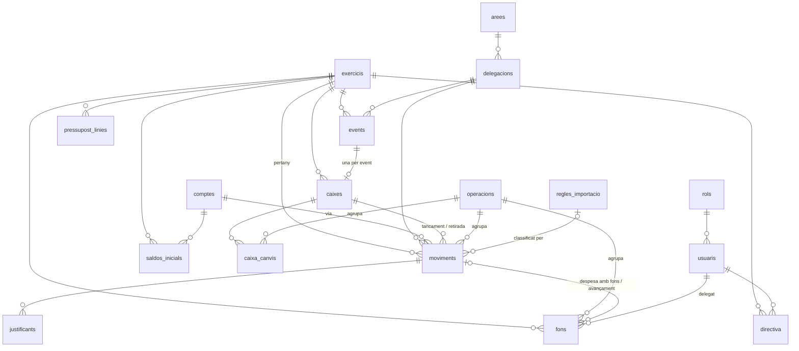

# Model de dades — Falla Portal a Supabase
## Redactat: 2026-10-13 · Estat: proposta per revisar amb Emilio (entrada de la Fase 1) · Decisions: D-021, D-024, D-025

Aquest document es llig sense context previ. Substitueix l'esborrany de taules del §4 de
`PLA_MIGRACIO_SUPABASE.md`. Es basa en `INVENTARI_FUNCIONAL.md` (què fa l'app), `INFORME_ANOMALIES_F0.md`
(què falla) i el perfil de les dades reals del 2026-10-13.

---

## 1. Per què no copiar les pestanyes

L'esborrany anterior feia una taula per pestanya. Això trasllada a Postgres els defectes del full:

| Defecte del full | Conseqüència vista a les dades o al codi |
|---|---|
| `via` és un text que ha de coincidir amb `bancs.codi`, més dos valors màgics (`app`, `Virtual`) | Llistes de vies fixes al codi; el 03 Banc no surt al Flux (A-21) |
| Els moviments guarden còpies de noms (`areaNom`, `delegacioNom`, `eventNom`, `responsable`) | Noms desfasats; un esborrat deixa orfes que ningú detecta (A-14) |
| Una acció de l'usuari crea diversos registres sense cap vincle comú (traspàs = 2 moviments + 1 fons; tancament = 2 moviments + 1 fons; despesa amb fons = 1 moviment + 1 fons) | Esborrar-ne un deixa els altres: 4 avançaments orfes (A-24); reobrir una caixa esborra per coincidència de text (`fontImport`+`eventId`) |
| Els apunts de canvi de caixa viuen a `02 Fons` amb un delegat fals (`_event`) | Cal excloure'ls a mà a cada càlcul de saldo (A-05) |
| Un tancament "sense event" s'inventa un `eventId` (`_se_…`) | No pot haver-hi clau forana cap a events (A-05) |
| Estats globals dins d'un JSON (`estats_exercicis`, bloqueig de pressupost d'una sola fila) | Es perden o s'apliquen a l'any que no toca (A-01, A-11) |
| Patrons de regles com a text separat per comes, ids de regla sense rastre | No se sap quina regla ha classificat un moviment |
| `bankHash` tractat com a clau | No és únic a la realitat (A-04) |

## 2. Principis
1. **Cada fet es guarda una sola vegada.** Els noms es lligen per clau forana; res de còpies.
2. **Cada registre sap d'on ve**: qui l'ha creat, quan, i de quina **operació** forma part.
3. **Les regles que avui només posa la pantalla, les posa la base de dades** (claus foranes, `CHECK`, índexs únics,
   transicions d'estat).
4. **Comportament i xifres 1:1 (D-025).** Cap columna nova canvia un total. Una vista reprodueix la forma
   antiga dels moviments perquè la UI (que continua llegint `DB`) canvie el mínim a la Fase 3.
5. **Tipus reals**: `date`, `time`, `numeric(12,2)`, `boolean`, enumeracions; mai text per a números o dates.
6. **Res s'esborra sense rastre**: `audit_log` per triggers (D-024).

## 3. Visió de conjunt

Grups: **exercici i organització** (`exercicis`, `arees`, `delegacions`, `events`), **diners** (`comptes`,
`saldos_inicials`, `moviments`, `justificants`, `fons`, `caixes`, `caixa_canvis`, `operacions`),
**planificació** (`pressupost_linies`, `pressupost_estat`, `pressupost_historial`), **persones i permisos**
(`usuaris`, `rols`, `rol_moduls`, `rol_reports`, `directiva`), **importació** (`regles_importacio`,
`fallesapp_passiu`), **sistema** (`config`, `audit_log`).

---

## 4. Taules

Convencions: tota taula de dades té `creat_at timestamptz default now()`, `creat_per uuid` (usuari autenticat) i,
si es pot editar, `modificat_at`/`modificat_per`; no es repeteixen a cada taula. Els `id` existents es
**conserven** com a `text` (justificants i enllaços en depenen); les files noves reben `gen_random_uuid()::text`.

### 4.1 Exercici i organització

**`exercicis`** — substitueix `exercicis`, `estats_exercicis` i part d'`anyFiscal` de `00 Config`.
| Columna | Tipus | Notes |
|---|---|---|
| `id` | text PK | `'25/26'`; `CHECK (id ~ '^\d{2}/\d{2}$')` |
| `data_inici`, `data_fi` | date | 01/04–31/03 (D-026), desades a cada exercici en lloc de fixes al codi (avui hi són en 4 llocs) |
| `data_obertura` | date | |
| `tancat` | boolean | A-01: es desa de veritat; **no bloqueja res** fins que Emilio ho decidisca |
| `data_tancament` | date | |
| `es_prova` | boolean | exercicis de prova |

**`arees`**: `id text PK` (`'01'`, `CHECK ~ '^\d{2}$'`), `nom`, `color` (ara es desa), `ordre`.
**`delegacions`**: `id text PK` (`'0102'`), `area_id FK`, `nom`; `UNIQUE (id, area_id)` per a la clau composta
de §4.2.
**`events`**: `id text PK`, `exercici_id FK`, `delegacio_id FK`, `nom`, `data_inici date`, `hora_inici time`,
`data_fi date`, `hora_fi time`, `responsable_id FK usuaris` (avui és un nom: A-07), `estat` (`pendent`…),
`per_defecte boolean`. Índex únic parcial: un sol `per_defecte` per exercici.

### 4.2 Diners

**`comptes`** — substitueix `07 Bancs` i converteix `via` en clau forana.
| Columna | Tipus | Notes |
|---|---|---|
| `id` | text PK | conserva `b1`, `b2`, `b3`, `b4`, `b1779146131300` |
| `codi` | text UNIQUE | `01 Banc`, `Efectiu`, `TPV`… (el que es mostra) |
| `nom` | text | |
| `tipus` | enum `banc` \| `efectiu` \| `tpv` \| `virtual` | |
| `iban` | text | `CHECK` de format quan és `banc`/`tpv`; el 02 Banc el té buit (cal omplir-lo) |
| `als_informes` | boolean | **reprodueix 1:1** l'exclusió de `via:'app'` de Dashboard, Resultats i Flux |

Un compte nou de tipus `virtual` per al valor màgic **`Virtual`** (bonificacions de falles.app, que sí compten com
a despesa). El valor `app` **no** es converteix en compte si s'accepta la proposta de §4.5 (consums de falles.app fora
del llibre major); si no s'accepta, es crea un compte `app` amb `als_informes=false`. El Flux i r4 passen a llistar els
comptes de la taula en lloc d'una llista fixa (A-21; els totals no canvien).

**`saldos_inicials`**: `PK (compte_id, exercici_id)`, `import numeric(12,2)`, `data date`. Clau forana real (A-03).

**`operacions`** — **nova**. Agrupa tot el que crea una acció de l'usuari, per esborrar-ho, desfer-ho o auditar-ho
junt.
| Columna | Tipus | Notes |
|---|---|---|
| `id` | text PK | |
| `tipus` | enum | `moviment_manual`, `despesa_amb_fons`, `avancament`, `lliurament`, `devolucio`, `reintegrament`, `ingres_tercer`, `traspas_banc_caixa`, `obrir_caixa`, `ampliar_canvi`, `retirada_caixa`, `tancar_caixa`, `importacio_extracte`, `importacio_csv`, `importacio_fallesapp`, `passiu_fallesapp`, `migracio` |
| `exercici_id` | FK | |
| `fitxer_nom`, `iban_detectat` | text | només importacions |
| `resum` | jsonb | p. ex. `{importades, ometudes, duplicats, files_ignorades}` (A-18: ja no s'ometen en silenci) |

Efectes: esborrar un moviment que forma part d'una operació proposa esborrar l'operació sencera (fi d'A-24 i
dels traspassos que quedaven solts); "desfer importació" esborra els moviments d'una importació; reobrir una
caixa esborra els moviments de l'operació `tancar_caixa`, no els que casen per text.

**`moviments`** — el llibre major. Una fila per ingrés o despesa.
| Columna | Tipus | Origen al full | Notes |
|---|---|---|---|
| `id` | text PK | `id` | es conserva tal qual (A-15) |
| `exercici_id` | FK not null | `anyFiscal` | **es conserva el valor desat**, no es recalcula de la data (A-10: 9 casos; decisió a part) |
| `data` | date not null | `data` | 1 moviment sense data a resoldre en migrar |
| `tipus` | enum `ingres` \| `despesa` | `tipus` (`ing`/`gast`) | |
| `import` | numeric(12,2) `CHECK > 0` | `import` | |
| `compte_id` | FK not null | `via` | per `codi` |
| `area_id` | FK null | `areaId` | null = excepció d'importació sense classificar |
| `delegacio_id` | null | `delegacioId` | **FK composta `(delegacio_id, area_id) → delegacions(id, area_id)`**: la delegació sempre és de l'àrea |
| `event_id` | FK null | `eventId` real | |
| `caixa_id` | FK null | `eventId` sintètic `_se_…` o de tancament | |
| `operacio_id` | FK null | — | reconstruïda en migrar on es pot |
| `font` | enum | `origen` + `fontImport` + `origenFons` | `manual`, `ingres_tercer`, `traspas_banc_caixa`, `extracte`, `csv_generic`, `fallesapp_transaccions`, `fallesapp_tickets`, `fallesapp_entrades`, `fallesapp_bonificacio`, `tancament_caixa`, `retirada_caixa` |
| `pagament_efectiu` | enum null | `origenFons` | `caixa` \| `fons_lliurats` \| `avancament` (només despeses en efectiu) |
| `concepte`, `establiment`, `notes` | text | | |
| `responsable_id` | FK usuaris null | `responsableEmail` | per email; si no casa, `responsable_extern` text |
| `conciliacio` | enum `pendent` \| `conciliat` \| `no_aplica` | `conciliacio` | per defecte amb la regla de `calcConciliacio` |
| `empremta` | text null | `bankHash` | **índex no únic** `(compte_id, empremta)` (A-04) |
| `regla_id` | FK null | (`assignatPer`, es perdia) | quina regla l'ha classificat |
| `motiu_sense_justificant` | text | `ticketMotiu` | |

Es deixen fora `areaNom`, `delegacioNom`, `eventNom`, `responsable` i `ticketUrl` (passa a `justificants`).

**`justificants`** — **nova**: `id`, `moviment_id FK on delete cascade`, `storage_path`, `nom_fitxer`, `tipus_mime`,
`mida`, `url_drive_original` (traçabilitat de la Fase 4). Un moviment pot tindre'n més d'un.

**`fons`** — només els diners en mans de **persones**.
| Columna | Tipus | Notes |
|---|---|---|
| `id` | text PK | |
| `exercici_id`, `data` | FK, date | |
| `tipus` | enum | `lliurament`, `regularitzacio`, `despesa_fons`, `devolucio`, `avancament`, `reintegrament` |
| `delegat_id` | FK usuaris **not null** | ja no hi ha `_event` |
| `import` | numeric(12,2) `CHECK > 0` | |
| `origen` | enum null | `caixa` \| `tercer` \| `banc` (lliurament i reintegrament; avui es perdia) |
| `moviment_id` | FK moviments null, **`on delete cascade`** | obligatori per a `despesa_fons` i `avancament` (`CHECK`) |
| `operacio_id` | FK null | |
| `nota` | text | |
| `registrat_per` | FK usuaris | avui és un nom (A-07): es resol per nom en migrar |

**`caixes`** — substitueix `03 Tancaments`; una caixa d'event, amb o sense event.
| Columna | Tipus | Notes |
|---|---|---|
| `id` | text PK | conserva l'`eventId` antic com a id (també els `_se_…`) |
| `exercici_id` | FK | |
| `event_id` | FK null | **índex únic parcial**: una caixa per event (1:1) |
| `descripcio` | text | obligatòria si no hi ha event (`CHECK`) |
| `data` | date | |
| `estat` | enum `oberta` \| `tancada` | transició només `oberta → tancada` i reobrir explícit |
| `efectiu`, `tpv`, `pagaments` | numeric(12,2) | `tpv` continua sense generar moviment (A-23, 1:1) |
| `area_id`, `delegacio_id` | FK | destí dels moviments del tancament |
| `notes` | text | ara es desa |

El **canvi** i les **retirades** no es guarden: es calculen (`caixa_canvis` i moviments `retirada_caixa` de la caixa).

**`caixa_canvis`** — els apunts que avui són `fons` amb `_event`: `id`, `caixa_id FK`, `data`, `tipus`
(`lliurament` \| `ampliacio` \| `devolucio`), `import CHECK > 0`, `operacio_id`.

### 4.3 Planificació
**`pressupost_linies`**: `id`, `exercici_id`, `delegacio_id FK`, `event_id FK null`, `concepte text null`,
`tipus` enum `event` \| `concepte` \| `varis`, `import numeric(12,2)` (`CHECK import > 0 OR tipus = 'varis'`), `notes`.
`UNIQUE NULLS NOT DISTINCT (exercici_id, delegacio_id, event_id, concepte)`. `Varis` deixa de ser una paraula
màgica i passa a ser un tipus; la lògica de recàlcul es manté igual (al client o en una funció).
**`pressupost_estat`**: `PK exercici_id`, `estat` enum `obert` \| `bloquejat`, `canviat_per`, `canviat_at` (A-11:
una fila per exercici).
**`pressupost_historial`**: `id`, `exercici_id`, `accio`, `usuari_id`, `data`, `motiu`.

### 4.4 Persones i permisos
**`usuaris`**: `id text PK`, `auth_user_id uuid UNIQUE` (s'omple en la primera entrada), `nom`, `email citext UNIQUE`,
`rol_id FK`, `actiu boolean`. Un usuari amb registres **es desactiva** en lloc d'esborrar-se (FK `restrict`; A-14):
per a ell és el mateix (no entra), i l'historial no queda orfe.
**`rols`**: `id`, `nom`, `color`, `pot_registrar`, `pot_fons`, `pot_importar`, `pot_configurar`, `pot_usuaris`,
`veu_tot`, `de_sistema` (els de sistema no s'esborren).
**`rol_moduls`**: `PK (rol_id, modul)`, `escriptori`, `barra`, `menu` (substitueix el JSON `modulVis`).
**`rol_reports`**: `PK (rol_id, report)`, `visible` (substitueix `reportVis`).
**`directiva`**: `id`, `exercici_id`, `usuari_id`, `area_id null`, `delegacio_id null`,
`CHECK (exactament un dels dos)`, `UNIQUE (exercici_id, usuari_id, area_id, delegacio_id)`.

### 4.5 Importació
**`regles_importacio`**: `id`, `compte_id FK null` (null = tots els comptes; el compte `app` substitueix la font
`'app'`), `patrons text[]`, `tipus` enum `assignar` \| `tpv` \| `ignorar`, `sentit` enum `ingres` \| `despesa` \|
`qualsevol`, `area_id`, `delegacio_id`, `concepte`, `prioritat int`, `activa`.
**`fallesapp_passiu`**: `id`, `exercici_id`, `data`, `total`, `fallers`, `operacio_id` — es guarda l'historial;
la pantalla mostra l'últim de l'exercici (1:1).

**`fallesapp_consums`** — **proposta, pendent de confirmar amb Emilio**. Què fa avui l'app amb falles.app (no hi ha
cap decisió escrita; reconstruït del codi i de les dades del 25/26):
| Què es puja | 25/26 | Tractament actual |
|---|---|---|
| Recàrregues d'efectiu | 149.943,20 € | moviment real (ingrés a Efectiu) |
| Recàrregues TPV | 2.836,50 € | moviment real al 01 Banc; probablement duplicat amb l'extracte (A-27) |
| Devolucions | 539,00 € | moviment real (despesa d'Efectiu) |
| **Consums per event** | 59.137,00 € | moviment amb `via:'app'` **exclòs** de Dashboard, Resultats i Flux; només s'usa a r3 (ingrés per event) i es veu a l'Historial |
| Bonificació moneders | 31.967,20 € | moviment real (despesa `Virtual`) |

Els consums no són diners que entren (ja van entrar com a recàrrega): són **dades estadístiques** per atribuir
ingressos als events. Proposta: taula pròpia `fallesapp_consums` (`id`, `exercici_id`, `event_id FK null`,
`area_id`, `delegacio_id`, `import`, `consums int`, `periode_inici`, `periode_fi`, `operacio_id`) en lloc de
moviments amb un compte fals. Les xifres de Dashboard, Resultats, Flux i pressupost no canvien (ja els excloïen);
r3 llegiria els ingressos de l'event de moviments **+** consums, amb el mateix resultat. Els consums deixarien
d'aparéixer a l'Historial de moviments (es veurien a la pantalla de Falles.app).

### 4.6 Sistema
**`config`**: `clau text PK`, `valor jsonb`. Queden: `exercici_actiu` (global, 1:1 A-02) i `justificant`
(`{mode, llindar}`). `drive_folders` desapareix (Storage).
**`audit_log`** (D-024): `id bigserial`, `at timestamptz`, `usuari_id`, `email`, `taula`, `fila_id`, `accio`
(`insert`/`update`/`delete`), `abans jsonb`, `despres jsonb`, `operacio_id`. Només lectura per a
`president`\|`treasury`; ningú no hi pot escriure directament.

---

## 5. Càlculs: vistes, no columnes
| Vista | Reprodueix |
|---|---|
| `v_moviments_app` | La forma antiga del moviment (`via`, `origen`, `fontImport`, `origenFons`, `areaNom`, `ticketUrl`…) per a la UI de la Fase 3 |
| `v_saldo_comptes` | Saldo inicial de l'exercici + ingressos − despeses per compte (inventari §5.1) |
| `v_caixes` | Canvi total, retirades i resultat net de cada caixa (inventari §5.6–5.7) |
| `v_saldo_fons_delegat` | Saldo de fons per delegat i exercici. **Fins que Emilio decidisca A-08, la UI continua amb les seues fórmules** |
| `v_pressupost_execucio` | Pla vs executat per delegació |

---

## 6. Correspondència amb el full
| Pestanya | Destí |
|---|---|
| `00 Config` | `exercicis` (exercicis, estats), `config` (anyFiscal → `exercici_actiu`, justificant), `rol_moduls`, `rol_reports`; `drive_folders` i `fappPassiu` es descarten |
| `01 Moviments` | `moviments` + `justificants` (de `ticketUrl`) + `operacions` reconstruïdes; els `via:'app'` (consums) a `fallesapp_consums` si s'accepta §4.5 |
| `02 Fons` | `fons` (tipus de persona) + `caixa_canvis` (`event_canvi`, `event_canvi_devolucio`) |
| `03 Tancaments` | `caixes` |
| `04`–`06` | `arees`, `delegacions`, `events` |
| `07 Bancs` | `comptes` (+ `app` i `Virtual`) |
| `08 Usuaris`, `14 Rols` | `usuaris`, `rols` |
| `09 Usuaris Assignacions` | `directiva` |
| `10`–`12` | `pressupost_linies`, `pressupost_estat`, `pressupost_historial` |
| `13 Regles CSV` | `regles_importacio` (patrons a array) |
| `15 Saldos` | `saldos_inicials` |
| `16 Fapp Passiu` | `fallesapp_passiu` |
| `08 Regles Import`, `15 Fapp Passiu`, `17 Moduls`, `18 Audit Log` | es descarten (antigues o buides) |

Operacions que es poden reconstruir amb les dades d'avui: despesa amb fons i avançament (`fons.movimentId`),
tancaments i retirades (`eventId` + `fontImport`), traspassos banc → caixa (`origenFons:'banc_caixa'`, per
parelles de data i import), importacions (`fontImport` + dia de creació de l'id). La resta queda amb
`operacio_id` nul i tipus `migracio`.

---

## 7. Què canvia per a l'usuari (res de les xifres)
- Esborrar una despesa amb avançament esborra també l'avançament (abans quedava orfe: A-24). És una correcció
  d'error, permesa per D-025.
- Desfer una importació sencera, i saber quina regla ha classificat cada moviment.
- Més d'un justificant per moviment.
- El color de l'àrea es desa; el bloqueig de pressupost és per exercici; l'exercici tancat es desa (però no
  bloqueja fins que es decidisca A-01).
- Un usuari amb historial es desactiva en lloc d'esborrar-se.
- Registre d'activitat i recuperació del que s'ha esborrat.

## 8. Decisions obertes del model (d'una en una)
1. ~~**Operacions**~~ — **Decidit (D-027, 2026-10-13)**: s'adopta la taula `operacions`.
2. ~~**Esborrar**~~ — **Decidit (D-028, 2026-10-13)**: esborrat real i recuperació des de `audit_log`; sense paperera.
3. **`exercici_id` dels moviments**: es conserva el desat (recomanat per a 1:1) i una vista avisa dels que no casen amb la data.
4. **Responsable dels moviments importats**: avui és qui importa; es manté (1:1)?
5. **Consums de falles.app** (§4.5): taula pròpia, fora del llibre major (recomanat), o compte `app` exclòs dels informes?
